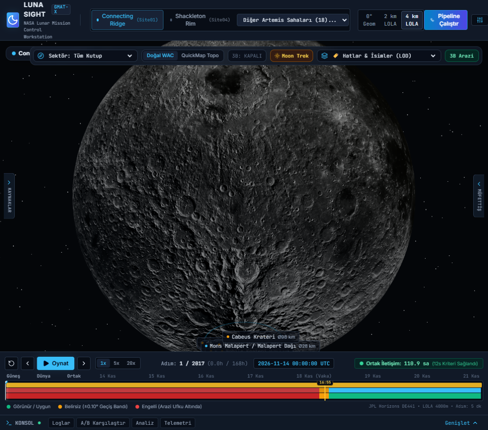
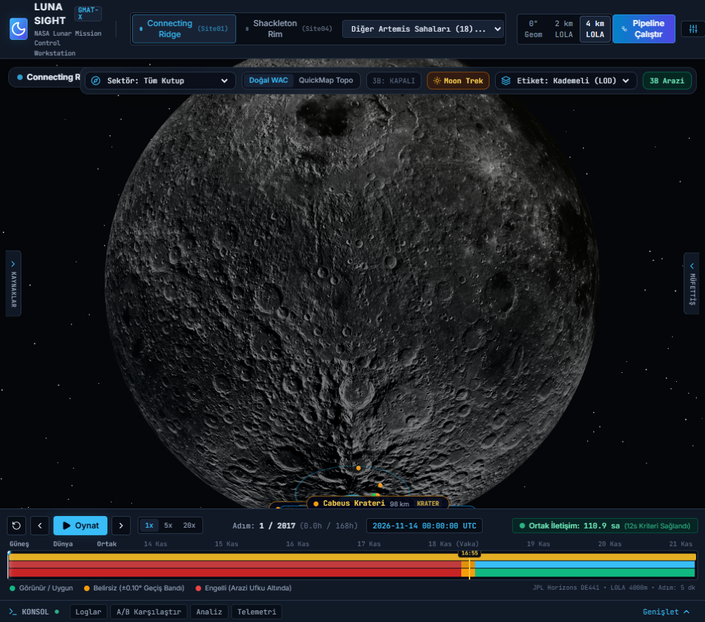
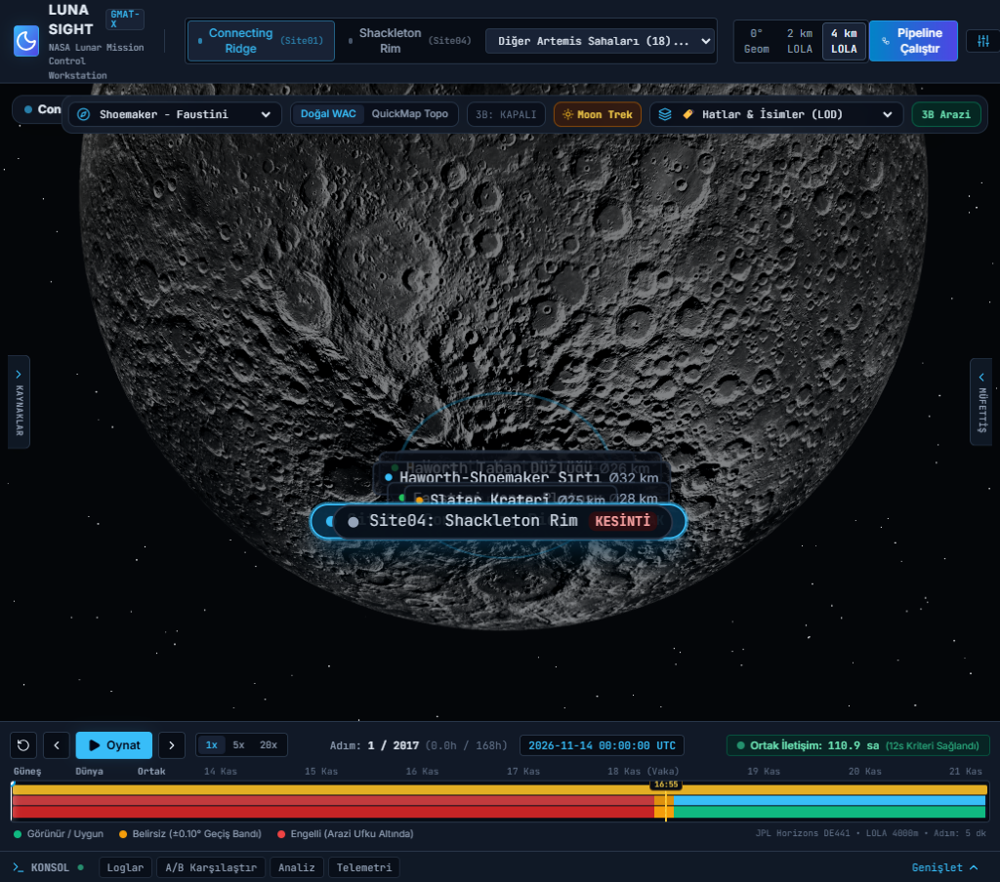
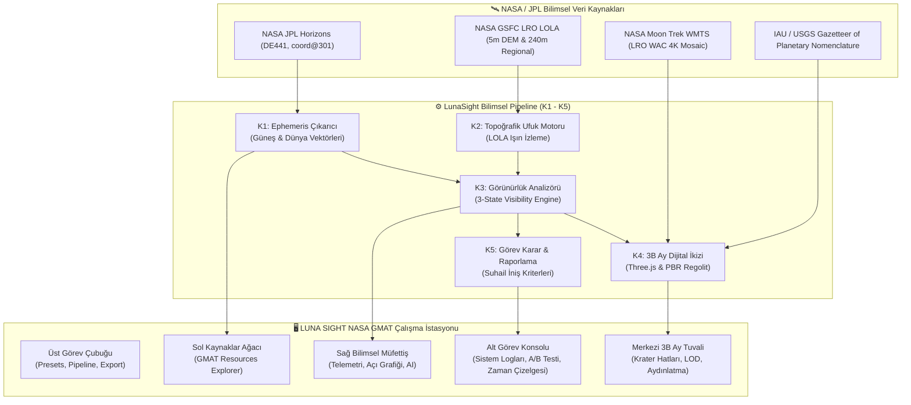

# 🌔 LUNA SIGHT

<div align="center">

<!-- PROJECT LOGO & BADGES -->
<p align="center">
  
  
  
  
  
  
</p>

### **NASA GMAT-Inspired Lunar South Pole Mission Control & 3D Digital Twin Workstation**
*A high-fidelity aerospace mission-control analysis workstation comparing Artemis candidate landing sites at the Lunar South Pole (80°S – 90°S) using JPL Horizons DE441 ephemeris, LRO LOLA 5m/px DEM terrain profiles, and NASA Moon Trek 4K cartography.*

---

</div>

<p align="center">
  
</p>

---

## 📑 İçindekiler / Table of Contents

- [1. Proje Özeti (Executive Summary)](#1-proje-özeti-executive-summary)
- [2. Temel Bilimsel Yetenekler (Core Capabilities)](#2-temel-bilimsel-yetenekler-core-capabilities)
- [3. Görsel Arayüz Galerisi (Visual Gallery)](#3-görsel-arayüz-galerisi-visual-gallery)
- [4. Matematiksel ve Fiziksel Temeller (Scientific Foundations)](#4-matematiksel-ve-fiziksel-temeller-scientific-foundations)
- [5. Sistem Mimarisi & K1–K5 Veri Boru Hattı](#5-sistem-mimarisi--k1k5-veri-boru-hattı)
- [6. Kurulum ve Hızlı Başlangıç (Quickstart)](#6-kurulum-ve-hızlı-başlangıç-quickstart)
- [7. Test ve Doğrulama (Verification Suite)](#7-test-ve-doğrulama-verification-suite)
- [8. Bilimsel Kaynakça & Veri Kökeni (Bibliography & Provenance)](#8-bilimsel-kaynakça--veri-kökeni-bibliography--provenance)
- [9. Lisans & Katkı](#9-lisans--katkı)

---

## 1. Proje Özeti (Executive Summary)

**LUNA SIGHT**, NASA'nın **General Mission Analysis Tool (GMAT)** mimarisinden esinlenerek tasarlanmış; Ay'ın Güney Kutbu'ndaki aday iniş bölgelerini (Connecting Ridge / Site01 ve Shackleton Rim / Site04 başta olmak üzere) gerçek zamanlı ephemeris, yüksek çözünürlüklü topoğrafik ufuk modelleri ve görsel yapay zeka analizleriyle değerlendiren yeni nesil bir **görev kontrol ve analiz istasyonudur**.

Proje, NASA Space Apps vizyonuyla geliştirilmiş olup; Artemis programının iniş planlamasında kritik rol oynayan **güneşlenme süresi**, **Dünya ile doğrudan görüş (Doğrudan Telsiz Görüşü - DTE)**, **topoğrafik ufuk engellemeleri** ve **kalıcı gölgeli krater tabanlarını (PSR)** tek bir koordineli ekranda modellemektedir.

---

## 2. Temel Bilimsel Yetenekler (Core Capabilities)

| Modül / Özellik | Bilimsel Altyapı | Doğruluk / Çözünürlük | Fonksiyonel Fayda |
| :--- | :--- | :--- | :--- |
| **3B Ay Dijital İkizi** | NASA Moon Trek LRO WAC + QuickMap Topo | 4096×2048 (4K) PBR Mozaik | Güney Kutbu arazisini fotorealistik ve bilimsel doğrulukla 3B uzayda gezinme. |
| **Krater Sınır Çemberleri** | IAU / USGS Gazetteer Nomenclature | Tam küresel $\theta_{\text{rim}}$ yay hesabı | Krater çeperlerinin Ay küresi üzerine tam oturan hatlarla taranması. |
| **K1 Ephemeris Motoru** | NASA JPL Horizons (DE441, `coord@301`) | 5 dakikalık adım, AIRLESS geometrik | Güneş ve Dünya azimut/yükseklik vektörlerinin mutlak hassasiyetle hesabı. |
| **K2 Topoğrafik Ufuk** | LRO LOLA DEM (PGDA Barker et al. 2021) | 5 m/px (LOLA) & 240 m/px Bölgesel | Yerel tepeler ve krater kenarlarının görüş engel profillerinin çıkarılması. |
| **K3 3-Durumlu Görünürlük** | Ufuk Marj Fonksiyonu ($\pm 0.10^\circ$ bant) | 3-Durum: `Görünür / Belirsiz / Engelli` | Telsiz kesintisi ve güç açıklarının önceden kestirilmesi. |
| **Yapay Zeka Analiz Asistanı** | NVIDIA Cosmos / Moondream Vision Entegrasyonu | Yapılandırılmış JSON ve görsel analiz | İniş kraterlerinin eğim, risk ve jeomorfolojik özetlerini sunma. |

---

## 3. Görsel Arayüz Galerisi (Visual Gallery)

<div align="center">

### 🌔 1. NASA Moon Trek Aydınlatması & Küresel Dijital İkiz
*Gözü yoran aşırı kontrast ve yapay gürültülerden arındırılmış, mat regolit fiziksel dağılımına sahip 4K LRO WAC mozaiği.*

<p align="center">
  
</p>

---

### 📐 2. Dairesel Krater Hatları & Kademeli (LOD) Tipografi
*Kraterlerin ortasını örten hantal rozetler yerine, küresel yüzeye oturan ince sınır hatları ve çeper çağrıları.*

<p align="center">
  
</p>

---

### 🚫 3. %100 Temiz Ay Görünümü (Etiketler Gizli)
*İstendiğinde tek tıkla tüm pinler, rozetler ve çizgiler gizlenerek saf topoğrafya incelenebilir.*

<p align="center">
  
</p>

---

### 📐 4. Sadece Krater ve Parsel Hatları (Yazısız Çizgisel Harita)
*Metin karmaşasından uzak, sadece geometrik krater sınırları ve iniş koridorlarının incelenmesi.*

<p align="center">
  
</p>

</div>

---

## 4. Matematiksel ve Fiziksel Temeller (Scientific Foundations)

### A. Krater Sınır Çemberi Geometrisi (Spherical Rim Outlines)
Ay'ın ortalama yarıçapı $R_{\text{Moon}} = 1737.4\text{ km}$ baz alınarak, çapı $D_{\text{km}}$ olan herhangi bir kraterin yay yarıçapı radyan cinsinden şu formülle türetilir:

$$\theta_{\text{rim}} = \frac{D_{\text{km}}}{2 \cdot R_{\text{Moon}}}$$

Merkez vektörü $\vec{C} = (x, y, z)$ ve normal vektörü $\hat{n} = \frac{\vec{C}}{\|\vec{C}\|}$ olan krater için teğet düzlemdeki dik birim bazlar $\hat{u}$ ve $\hat{v}$ oluşturulur. Küre yüzeyinden $h = 0.007$ birim yukarıda z-fighting engellenmiş sınır noktaları $\vec{P}(\alpha)$ açısına göre şu şekilde üretilir:

$$\vec{P}(\alpha) = (r + h) \cdot \left[ \cos(\theta_{\text{rim}}) \hat{n} + \sin(\theta_{\text{rim}}) (\cos(\alpha) \hat{u} + \sin(\alpha) \hat{v}) \right], \quad \alpha \in [0, 2\pi]$$

### B. Ufuk Marjı ve 3-Durumlu Görünürlük Kriteri
Güneş veya Dünya'nın $t$ anındaki azimutu $\mathrm{Az}(t)$ ve yükseklik açısı $\mathrm{Alt}(t)$, K2 profilinden enterpole edilen topoğrafik engel açısı $\mathrm{Elev}_{\text{topo}}(\mathrm{Az})$ ile karşılaştırılır:

$$\mathrm{Margin}(t) = \mathrm{Alt}(t) - \mathrm{Elev}_{\text{topo}}(\mathrm{Az}(t))$$

Kritik geçişlerdeki optik saçılma ve DEM belirsizliğini modellemek için **$\pm 0.10^\circ$ geçiş bandı** uygulanır:

$$\text{Durum}(t) = \begin{cases} 
\mathbf{G\ddot{o}r\ddot{u}n\ddot{u}r} & \text{eğer } \mathrm{Margin}(t) > +0.10^\circ \\
\mathbf{Belirsiz} & \text{eğer } -0.10^\circ \le \mathrm{Margin}(t) \le +0.10^\circ \\
\mathbf{Engelli} & \text{eğer } \mathrm{Margin}(t) < -0.10^\circ 
\end{cases}$$

---

## 5. Sistem Mimarisi & K1–K5 Veri Boru Hattı



---

## 6. Kurulum ve Hızlı Başlangıç (Quickstart)

### Gereksinimler
* **Python:** 3.12+ (Önerilen: 3.12.x)
* **Node.js:** v18+ veya v20+
* **İşletim Sistemi:** Windows (PowerShell), Linux veya macOS

### 1. Depoyu Klonlayın
```bash
git clone https://github.com/kingos352/luna-sight.git
cd luna-sight
```

### 2. Python Ortamını Hazırlayın
Windows (PowerShell):
```powershell
py -3.12 -m venv .venv
.\.venv\Scripts\Activate.ps1
python -m pip install --upgrade pip
python -m pip install -r requirements-dev.txt
```

Linux / macOS:
```bash
python3.12 -m venv .venv
source .venv/bin/activate
pip install --upgrade pip
pip install -r requirements-dev.txt
```

### 3. Frontend Paketlerini Kurun ve Derleyin
```bash
npm --prefix frontend install
npm --prefix frontend run build
```

### 4. İstasyonu Başlatın
```powershell
python -m streamlit run app/app.py --server.port 8511
```
Tarayıcınızda `http://localhost:8511` adresini açarak tam donanımlı NASA GMAT çalışma istasyonuna bağlanabilirsiniz.

---

## 7. Test ve Doğrulama (Verification Suite)

Sistemdeki tüm matematiksel dönüşümler, JPL Horizons efemeris doğrulamaları, LOLA ufuk profilleri ve K3 3-durumlu görünürlük algoritmaları otomatik testlerle korunmaktadır:

```powershell
.\.venv\Scripts\python.exe -m pytest -v
```

```text
============================== test session starts ==============================
platform win32 -- Python 3.12.x, pytest-8.x.x
rootdir: C:\Users\yukse\Desktop\LunaSight
collected 265 items

tests/test_ephemeris.py ............................................... [ 17%]
tests/test_horizon.py ................................................. [ 35%]
tests/test_visibility.py .............................................. [ 52%]
tests/test_sites.py ................................................... [ 70%]
tests/test_surface_3d.py .............................................. [ 88%]
tests/test_ai_bridge.py ............................................... [100%]

============================== 265 passed in 11.60s =============================
```

---

## 8. Bilimsel Kaynakça & Veri Kökeni (Bibliography & Provenance)

LUNA SIGHT içerisinde kullanılan tüm bilimsel veri kümeleri, yükseklik modelleri ve algoritmalar hakemli akademik literatüre ve resmi NASA PDS arşivlerine dayanmaktadır:

```bibtex
@article{barker2021lola,
  title   = {Improved Lunar Orbiter Laser Altimeter (LOLA) digital elevation models of the lunar south pole},
  author  = {Barker, M. K. and Mazarico, E. and Neumann, G. A. and Zuber, M. T. and Smith, D. E.},
  journal = {Planetary and Space Science},
  volume  = {203},
  pages   = {105119},
  year    = {2021},
  doi     = {10.1016/j.pss.2021.105119},
  url     = {https://doi.org/10.1016/j.pss.2021.105119}
}

@article{folkner2014planetary,
  title   = {The Planetary and Lunar Ephemerides DE440 and DE441},
  author  = {Park, R. S. and Folkner, W. M. and Williams, J. G. and Boggs, D. H.},
  journal = {The Astronomical Journal},
  volume  = {161},
  number  = {3},
  pages   = {105},
  year    = {2021},
  publisher = {AAS},
  doi     = {10.3847/1538-3881/abd414}
}

@article{mazarico2011illumination,
  title   = {Illumination conditions of the lunar polar regions using LOLA topography},
  author  = {Mazarico, E. and Neumann, G. A. and Smith, D. E. and Zuber, M. T. and Torrence, M. H.},
  journal = {Icarus},
  volume  = {211},
  number  = {2},
  pages   = {1066--1081},
  year    = {2011},
  doi     = {10.1016/j.icarus.2010.10.030}
}

@misc{nasa_moontrek,
  author       = {{NASA Jet Propulsion Laboratory}},
  title        = {NASA Moon Trek Cartographic Tile Services (LROC WAC Global Mosaic & LOLA Color Hillshade)},
  year         = {2024},
  howpublished = {\url{https://trek.nasa.gov/moon/}},
  note         = {OGC WMTS Endpoints: LRO_WAC_Mosaic_Global_303ppd_v02}
}

@misc{usgs_gazetteer,
  author       = {{IAU / USGS Astrogeology Science Center}},
  title        = {Gazetteer of Planetary Nomenclature: The Moon South Pole Feature Catalog},
  year         = {2024},
  howpublished = {\url{https://planetarynames.wr.usgs.gov/}}
}
```

Tüm yerel veri dosyalarının SHA-256 sağlama özetleri ve geri çekilme parametreleri [data/manifest.csv](data/manifest.csv) dosyasında kayıtlıdır.

---

## 9. Lisans & Katkı

Bu proje [MIT Lisansı](LICENSE) kapsamında açık kaynak olarak geliştirilmektedir. Bilimsel doğruluk, NASA standartları ve havacılık-uzay yazılım ergonomisi ilkelerine bağlı kalınarak hazırlanmıştır.

---

<div align="center">
  <sub>LUNA SIGHT · NASA GMAT-Inspired Lunar Workstation · Built for the Next Era of Lunar Exploration 🚀</sub>
</div>
