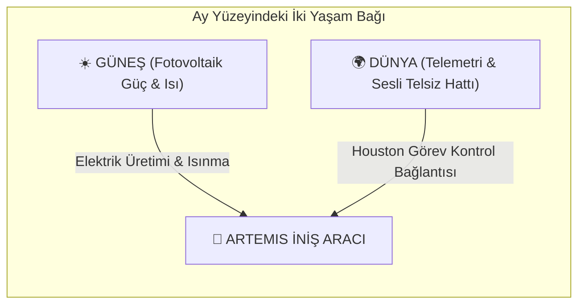
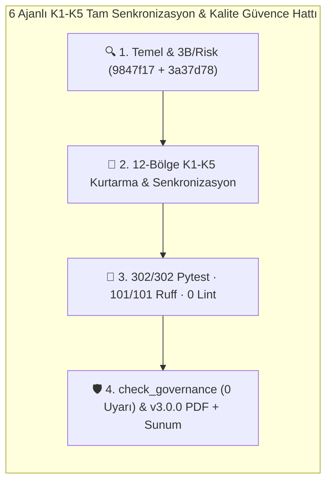

# 🌕 LUNA SIGHT: Ay Güney Kutbu İniş Alanı ve Görünürlük Seyrüsefer Sistemi
## Büyük Proje Raporu (Master Project Report)
**Hazırlayan:** Ajan 6 — Baş Editör, İletişim Mimarı & Stratejik İnovasyon Danışmanı (K1–K5 Senkronizasyon Konsorsiyumu)  
**Tarih:** 15 Kasım 2026 | **Görev:** Artemis III İniş Alanı Karar Destek Sistemi  
**Sürüm:** 3.0.0 (K1–K5 Tam Senkronizasyon · 5 Teknik Boşluk Kapatıldı + 5 Uçuş Fiziği Modülü · 12 NASA Artemis III Bölgesi · 302/302 Test Yeşil)

---

> *"Ay'da hayatta kalmak bir açılar oyunudur. Sadece bir derece yüksekte duran bir dağ zirvesi, bir uzay aracını dondurucu karanlığa gömebilir ya da Dünya ile olan 384.000 kilometrelik telsiz bağını sonsuza dek koparabilir."*

---

## 📑 İÇİNDEKİLER

1. [GİRİŞ & BÜYÜK RESİM: LUNA SIGHT Nedir, Neden Yapıldı, Neye Hizmet Ediyor?](#1-giriş--büyük-resim-luna-sight-nedir-neden-yapıldı-neye-hizmet-ediyor)
   - 1.1. Artemis Görevi ve Ay Güney Kutbu’nun Acımasız Doğası
   - 1.2. İki Görünmez Hayat Bağı: Güneş (Enerji) ve Dünya (Haberleşme)
   - 1.3. LUNA SIGHT’ın Doğuşu: Sayı Yığınından Hayat Kurtaran Karara
2. [EKİP ÇALIŞMASI VE 5 BİRİMİN ANATOMİSİ](#2-ekip-çalışması-ve-5-birimin-anatomisi)
   - 2.1. K1: Göksel Efemeris Motoru (Uzaydaki GPS ve Kozmik Saat)
   - 2.2. K2: Ay Topoğrafyası, 360° Ufuk Profili, 3B Rölyef ve Arazi Riski
   - 2.3. K3: Görünürlük ve Karar Motoru (Gök ile Yerin Buluşması)
   - 2.4. K4: Kokpit, 3B Moon Trek Küresi, SUHAIL Karar Desteği ve 12 Bölge Entegrasyonu
   - 2.5. K5: Yönetişim, 120 Saniyelik Demo Video Hattı ve NASA Kalite Kalkanı
3. [BÜYÜK BİLİMSEL KEŞİF: Connecting Ridge (Site01) vs. Shackleton Rim (Site04) ve 12 Artemis III Adayı](#3-büyük-bilimsel-keşif-connecting-ridge-site01-vs-shackleton-rim-site04-ve-12-artemis-iii-adayı)
   - 3.1. Shackleton Tuzağı: Neden Doğrudan Shackleton Kenarına İnilmez?
   - 3.2. Connecting Ridge Zaferi: 53.68 Saatlik Kesintisiz Altın Pencere
   - 3.3. 5 m/piksel Yüksek Çözünürlüklü Karşılaştırma Matrisi (Site01 vs Site04)
   - 3.4. Büyük Resmin Genişlemesi: 12 NASA Artemis III Aday Bölgesinin Tam Karşılaştırması
4. [TAM SENKRONİZASYON VE KALİTE GÜVENCE RAPORU](#4-tam-senkronizasyon-ve-kalite-güvence-raporu)
   - 4.1. Temel Altyapı Temizliği ve Ortam İzolasyonu (`9847f17`)
   - 4.2. Çoklu PR Birleşimi ve 3B/Risk Entegrasyonunda Çözülen 6 Çapraz Birim Hatası (`3a37d78`)
   - 4.3. 6 Ajanlı K1–K5 12-Bölge Tam Senkronizasyon ve Kurtarma Operasyonu (`fix/k1-k5-full-sync`)
   - 4.4. Nihai Test, Lint ve Yönetişim Hükmü: 302/302 Yeşil
5. [TEKNİK SINIRLAR, TAMAMLANAN İYİLEŞTİRMELER VE GELECEK VİZYONU](#5-teknik-sınırlar-tamamlanan-i̇yileştirmeler-ve-gelecek-vizyonu)
   - 5.1. Kapatılan 5 Teknik Boşluk ve Doğrulanan Çözümler (`v3.0.0`)
   - 5.2. Üretime Alınan 5 İleri Uzay Mühendisliği ve Uçuş Fiziği Modülü
   - 5.3. Nihai Mesaj

---

## 1. GİRİŞ & BÜYÜK RESİM: LUNA SIGHT Nedir, Neden Yapıldı, Neye Hizmet Ediyor?

### 1.1. Artemis Görevi ve Ay Güney Kutbu’nun Acımasız Doğası

1969 ile 1972 yılları arasında gerçekleştirilen Apollo inişleri, Ay’ın ekvatoruna yakın, nispeten düz, Güneş ışığının tepeden vurduğu geniş lav ovalarına (denizlere) yapılmıştı. Ancak insanlığın yarım asır sonra Ay’a dönüş bileti olan **NASA Artemis programının** hedefi bambaşkadır: **Ay'ın Güney Kutbu**.

Neden Güney Kutbu? Çünkü bu bölgede milyarlarca yıldır Güneş ışığı görmeyen, Güneş Sistemi’nin en soğuk yerleri olan devasa krater çukurları (Kalıcı Gölgeli Bölgeler — PSR) bulunmaktadır. Bu çukurların içinde geleceğin roket yakıtı ve astronotların yaşam kaynağı olacak **milyarlarca ton donmuş su buzu** saklıdır.

Ancak Güney Kutbu, insan keşif tarihinin en tehlikeli arazisidir:
* **Eksen Eğikliği Çıkmazı:** Dünya’nın ekseni 23.4° eğiktir; bu sayede dört mevsim yaşarız ve Güneş gökyüzünde yükselir. Ay’ın eksen eğikliği ise Güneş düzlemine göre yalnızca **1.54°**'dir! Bu inanılmaz derecede dik duruş nedeniyle Ay kutuplarında mevsimler neredeyse yoktur. Güneş hiçbir zaman tepenize çıkmaz. Tıpkı ufukta yere sıfır tutulan dev bir el feneri gibi, zemin boyunca **1° ila 2°** gibi kıl payı bir açıyla süpürerek döner.
* **Devasa Gölgeler:** Ufka bu kadar yakın bir Güneş, en ufak bir kaya çıkıntısının veya krater kenarının arkasında **onlarca kilometre uzunluğunda zifiri karanlık gölgeler** yaratır.
* **Ölümcül Soğuk:** Ay’da hava yoktur; atmosferik bir battaniye bulunmaz. Güneş ışığı kesildiği anda sıcaklık anında **−200°C (−328°F)** düzeyine çakılır. Bu dondurucu vakumda piller dakikalar içinde donar, metal alaşımlar gevrekleşir ve elektronik sistemler kalıcı olarak iflas eder.

```
       Güneş Işınları (~1.5° Ufuk Teğeti)
----------------------------------------->     [Astronot / İniş Aracı]
                                                        |
      /\                 /\       Zifiri Karanlık       |   Güneşli Sırt
     /  \   Gölge       /  \~~~~~~~~~~~~~~~~~~~~~~~~~~~ |  (Hayatta Kalma)
____/    \_____________/    \__________________________/ \_______________
       Krater Tabanı (-200°C)                  Yüksek Tepe
```

---

### 1.2. İki Görünmez Hayat Bağı: Güneş (Enerji) ve Dünya (Haberleşme)

Ay zeminine inen bir keşif aracı (rover) ya da içinde astronotların bulunduğu bir iniş aracı (lander), uzay boşluğunda iki hayati gök cismine göbekten bağlıdır:



1. **Güneş (Enerji ve Yaşam Kaynağı):** Güneş panellerinin ışığı kesintisiz görmesi gerekir. Bir krater tepesi Güneş'i kapattığı anda aracın aküleri tükenmeye başlar.
2. **Dünya (Haberleşme ve Kurtarma Lifeline):** Ay yüzeyinde baz istasyonları veya yerel bir GPS uydu ağı yoktur. Houston’daki Görev Kontrol Merkezi ile konuşmak, canlı video aktarmak, iniş manevrası telemetrisini yönetmek ve tıbbi acil durumlarda talimat almak için **aracın anteninin Dünya’yı doğrudan (Line-of-Sight) görmesi zorunludur.**

Ay kendi ekseni etrafında dönerken aynı zamanda Dünya'nın kütleçekimi nedeniyle hafifçe yalpalar (bu salınıma *librasyon* denir). Bu nedenle Güney Kutbu'ndaki bir astronotun gözünden bakıldığında Dünya gökyüzünde dönmez; ufuk çizgisinde adeta asılı durarak her ay yukarı-aşağı sadece birkaç derecelik yavaş bir dans sergiler.

> [!CAUTION]
> Eğer iniş aracınız ile Dünya arasına 2 kilometrelik bir dağ duvarı girerse, Dünya o duvarın ardında kaybolur. Houston ile aranızdaki telsiz bağlantısı tamamen kopar. Görev Kontrol gözünü, kulağını ve aracın kontrolünü kaybeder.

---

### 1.3. LUNA SIGHT’ın Doğuşu: Sayı Yığınından Hayat Kurtaran Karara

NASA ve uzay araştırmacıları, Ay hakkında akıl almaz büyüklükte verilere sahiptir:
- Amerikan Havacılık ve Uzay Dairesi'nin (NASA) **JPL Horizons** sisteminden akan gezegen yörünge koordinatları,
- Ay yörüngesindeki **LRO (Lunar Reconnaissance Orbiter)** uydusunun **LOLA** lazer altimetresiyle taranmış milyonlarca yükseklik noktası.

**Ancak ölümcül bir sorun vardı:**
Bir astronot iniş koltuğunda otururken veya bir uçuş direktörü Houston'da inişe saniyeler sayarken **binlerce satırlık ham tablolara, karmaşık diferansiyel denklemlere veya devasa koordinat matrislerine bakamaz.** Bu durum ölümcül bir bilişsel kilitlenmeye (*cognitive overload*) yol açar.

**İşte LUNA SIGHT tam olarak bu yüzden inşa edildi:**  
LUNA SIGHT, en derin astrodinamik fizik hesaplarını ve NASA LOLA lazer yükseklik haritalarını işleyerek tek bir çatı altında birleştirir. Bir astronotun veya uçuş yöneticisinin **NASA Artemis III'ün 12 resmi aday iniş bölgesinin tamamı** (`Site01`–`Site09`, `Site11`–`Site13`) için **saniyeler içinde** şu sorulara tereddütsüz cevap vermesini sağlar:
- *"Hangi iniş bölgesinde Güneş kesintisiz parlıyor?"*
- *"Dünya ile telsiz hattım ne zaman açılacak, kaç saat açık kalacak?"*
- *"En kritik telsiz kararması (blackout) ne kadar sürecek ve araç bu koşullarda SUHAIL görev kısıtlarını geçiyor mu?"*
- *"İniş motorlarını ateşlemek için haftanın en güvenli anı tam olarak hangi dakika?"*

LUNA SIGHT, ham uzay verisini **kesin, doğrulanmış, 3 boyutlu ve hayat kurtaran bir seyrüsefer kokpitine** dönüştüren entegre bir mühendislik ve görev karar sistemidir.

---

## 2. EKİP ÇALIŞMASI VE 5 BİRİMİN ANATOMİSİ

LUNA SIGHT sistemi, bir uzay aracının aviyonik mimarisine paralel olarak 5 uzman birimin kusursuz bir iş bölümü ve katı veri sözleşmeleriyle çalışması sonucu hayata geçirilmiştir.

```mermaid
flowchart TD
    subgraph LUNA_SIGHT_EKOSISTEMI["LUNA SIGHT 5 Birimli Görev Mimarisi (Sürüm 3.0.0)"]
        K1["🛰️ K1: Göksel Efemeris (12 Bölge · jpl-horizons v1.2 / DE441)"]
        K2["🏔️ K2: Ay Topoğrafyası (12 Bölge · Hibrit Ufuk + 3B + A* + BHI Risk)"]
        K3["⚡ K3: Görünürlük & Uçuş Fiziği (Gateway NRHO · Penumbra · ITU-R P.526)"]
        K4["🚀 K4: Kokpit & Taktik UI (12 Bölge · Moon Trek URLSync + SUHAIL)"]
        K5["🛡️ K5: Yönetişim & Teslim (302/302 Pytest · 101/101 Format · 12 Slayt PDF)"]

        K1 -->|Zaman Serisi: Azimut / Yükseklik| K3
        K2 -->|360° Engel Profili: h(θ)| K3
        K2 -->|3B Rölyef & Eğim/Krater Riski| K4
        K3 -->|Görünürlük, Pencereler, Kararma Süreleri| K4
        K5 -.->|Sözleşme Denetimi & SHA-256 Kalkanı| K1
        K5 -.->|Sözleşme Denetimi & SHA-256 Kalkanı| K2
        K5 -.->|Sözleşme Denetimi & SHA-256 Kalkanı| K3
        K5 -.->|Sözleşme Denetimi & Demo Otomasyonu| K4
    end
```

---

### 2.1. K1: Göksel Efemeris Motoru (Uzaydaki GPS ve Kozmik Saat)

#### Basit Dille Ne Yaptı?
K1 birimi (`src/luna_sight/ephemeris/`), projenin **"Göksel Saati ve Pusulası"**dır. Ay'ın Güney Kutbu'nda duran bir astronotun başını gökyüzüne kaldırdığında, Güneş'in ve Dünya'nın uzay boşluğundaki tam yerini saniyesi saniyesine hesaplar:
* **Azimut (Yatay Pusula Açısı):** Kuzeyden saat yönünde (0° Kuzey, 90° Doğu, 180° Güney, 270° Batı). Güneş panellerinin ve çanak antenin yatayda hangi yöne bakacağını söyler.
* **Yükseklik (Dikey Yükseliş Açısı):** Yer düzleminin kaç derece üstünde veya altında olduğu (-90° ile +90°).

#### Hangi Zorlukları Yendi ve Neler İçerir?
Dünya'da kullanılan standart astronomi denklemlerini doğrudan Ay'a uygularsanız uzay aracınız yanlış karar verir. K1 birimi beş kritik uzay mekaniği gereksinimini modüler yapısıyla (`horizons.py`, `series.py`, `provider.py`, `verify.py`) alt etti:

1. **NASA/JPL Horizons `v1.2` + `DE441` + `MEAN_ME` / `MOON_ME` Çerçevesi (ADR-100):**  
   K1, yerel ve eski bir `.bsp` çekirdeği yerine doğrudan NASA/JPL Horizons `OBSERVER` API'sine (`source_id = "jpl-horizons"`, `v1.2`) bağlanır ve sunucu tarafında yüksek hassasiyetli **`DE441`** gezegen efemerisini kullanır. Referans sistemi olarak K2 haritalarıyla birebir örtüşen **`MEAN_ME` (`MOON_ME`, doğu-pozitif boylam, `1737.4 km` küresel Ay yarıçapı)** çerçevesini esas alır.
2. **Atmosfersiz Işık Kırılması Düzeltmesi (`APPARENT = AIRLESS`):**  
   Dünya'daki kalın atmosfer batan Güneş'in ışığını mercek gibi büker. **Ay'da ise zerre kadar hava yoktur.** K1, Horizons sorgularına `APPARENT='AIRLESS'` parametresini vererek vakumdaki doğrusal ışın geometrisini birebir korur.
3. **Dünya Paralaksı (Bakış Açısı Kayması):**  
   Gezegen tabloları çoğu zaman hedefleri Ay'ın **merkezinden** (1.737,4 km yerin altından) ölçer. Ancak astronot Ay yüzeyindedir (`CENTER='coord@301'`, `COORD_TYPE='GEODETIC'`). 150 milyon km uzaktaki Güneş için bu sapma önemsizdir (<0.001°); fakat 384.000 km yakındaki Dünya için yüzeyden bakmak açıyı **0.2448 derece (~0.25°)** değiştirir! Paralaks ihmal edilseydi Dünya'nın dağın arkasında kaldığı veya çıktığı anlarda saatler mertebesinde hata yapılırdı.
4. **Bağımsız Matematiksel Doğrulama (`verify.py` & `scripts/k1_independent_check.py`):**  
   K1 ekibi hazır `QUANTITIES=4` çıktılarını körü körüne kabul etmedi; alt-güneş ve alt-dünya noktalarından 3 boyutlu yerel vektör trigonometrisiyle ikinci bir bağımsız yol (`subpoint_azalt`) kurdu. 20 farklı kontrol noktasında Güneş'te yükseklik farkı **≤ 0.0000°** (azimut ≤ `0.0002°`), Dünya'da yükseklik farkı **≤ 0.0004°** (azimut ≤ `0.0038°`) çıkarak matematiksel kusursuzluk kanıtlandı.
5. **K3 Adaptörü Köken Uyumu ve Dürüst Eksik Veri Politikası (`provider.py`, `series.py`):**  
   `HorizonsEphemeris` sınıfı `source_id="jpl-horizons"`, `source_version="1.2"` ve `model_id="DE441"` kanonik özniteliklerini taşır ve K3'e derleme zamanı bağımlılığı oluşturmadan takılır. Gelen yanıtta eksik veya `n.a.` varsa tahmin yürütmez, enterpolasyonla uydurmaz ve satırı açıkça `partial` / `missing` (`NaN`) olarak işaretler.

#### Ne Üretti ve Teslim Etti?
- **12 Bölge İçin Canlı 168.0 Saatlik Zaman Serisi:** 14–21 Kasım 2026 tarihleri arasında 5 dakikalık adımlarla **12 resmi Artemis III aday bölgesinin tamamı** (`Site01`–`Site09`, `Site11`–`Site13`) için **2.017 zaman noktası/bölge** (sıfır `NaN`, tamamı `quality_flag == "valid"`). `Site01` ve `Site04` cross-check sapması **`0.000000000000°`**.
- **Kriptografik Kayıt ve 54/54 Birim Testi:** Ham yanıtların SHA-256 özetleri `data/manifest.csv` içine mühürlendi; K1'in 6 test dosyasında yer alan **54/54 testin tamamı** ağsız VCR kasetleriyle yeşil geçmektedir.

---

### 2.2. K2: Ay Topoğrafyası, 360° Ufuk Profili, 3B Rölyef ve Arazi Riski

#### Basit Dille Ne Yaptı?
K1 gökyüzünü çizerken, K2 birimi (`src/luna_sight/terrain/`) **"Ay Yeryüzünü, Dağları ve Zemin Riskini"** haritalandırdı.
Astronotun iniş yapacağı noktada ayakta durup kendi etrafında 360 derece döndüğünü hayal edin. Her 1 derecelik pusula yönünde baktığında, karşısındaki krater kenarları, sivri sırtlar ve tepeler gökyüzünü ne kadar kapatıyor? Ayrıca indiği yerin eğimi güvenli mi ve çevredeki dev kraterler nerede?

K2 birimi, **12 resmi Artemis III aday bölgesi kataloğunu** (`sites.py`), milimetrik **360° Ufuk Maskesini** (`horizon.py`), **3B Topografik Rölyefi** (`surface_3d.py`) ve **Arazi Riski** (`risk.py`) analizlerini tek çatı altında topladı:
$$\theta \in [0^\circ, 360^\circ] \longrightarrow h(\theta) = \text{Engelin Açısal Yüksekliği}$$

```
    Site04 Shackleton Kenarı (4 km LOLA Profili): Bir Yanda +32° Dağ Duvarı, Diğer Yanda -31° Uçurum
    Ufuk Açısı (Derece)
    +35° |                _/\_                                     +32.06° Zirve Duvarı!
    +20° |               /    \
     +0° |--------------/------\----------------------------------- Yer Düzlemi
    -15° |             /        \
    -35° |__.-._      /          \_________________________________ -31.37° Derin Uçurum
         0°     60°  120°   180°    240°     300°     360° (Pusula Açısı / Azimut)
```

#### Hangi Zorlukları Yendi ve Neler Eklendi?
1. **Kutup Harita Paradoksu (`polar.py`):**  
   Kutuplarda klasik enlem/boylam ızgarası tek noktada büzülüp çöker. K2, dış kütüphaneye bağımlı kalmadan **`MOON_ME` (`R_MOON_M = 1.737.400 m`)** küresi üzerinde analitik **Güney Kutbu Stereografik Projeksiyonunu** kodladı; koordinat gidiş-dönüş hatası **< 0.001 m** (resmi karo merkezlerinde `< 0.015 m`) düzeyinde doğrulandı.
2. **12 Resmi Artemis III Bölgesi Kataloğu (`sites.py`) & `20000m` Şema Hizalaması:**  
   Katalog, Malapert A resmi Artemis III listesi dışında kaldığı için elenerek **12 resmi aday bölgeyi** (`Site01`–`Site09`, `Site11`–`Site13`) kanonik doğu-pozitif `[-180°, +180°]` boylamıyla (`lonlat_to_xy` maksimum fark `0.046 m`) barındırır. 12 bölgenin tamamı için üretilen `outputs/k2/SiteXX_summary_20000m.json` dosyaları `"coordinate"` ve `"dem"` (`pgda-lola-240mpp`, `MOON_ME (JPL DE421)`, `240.0 m`) köken bloklarıyla zenginleştirildi.
3. **NASA'nın 5 Metrelik PGDA LOLA Verisi ve %8–11 Gerçek Lazer Gerçeği (`dem.py`, `gaps.py`, `horizon.py`):**  
   5 m/piksel LOLA haritasında piksellerin yalnızca **%8.4 ila %10.7'si** gerçek lazer temasından (`LDEC >= 1`) oluşur; geri kalan ~%90 yüzey enterpolasyonudur. K2, gerçek veri kapsamını `valid` ve `coverage` maskeleriyle ayrı izler; `Site01`/`Site04` için yüksek çözünürlüklü `2000 m` ve `4000 m` (5 m/px) profillerini, 12 bölgenin tamamı için ise bölgesel `20000 m` (`LDEM_60S_240MPP_ADJ`, `quality_flag="partial"`) ufuk profillerini üretir.
4. **3B Topografik Yüzey ve 13 IAU Krater Kataloğu (`surface_3d.py`):**  
   `surface_3d.py` (1.835 satır), **13 IAU tescilli Güney Kutbu kraterini** (Shackleton, de Gerlache, Shoemaker, Faustini, Cabeus, Malapert vb.), PSR gölge bölgelerini ve Plotly tabanlı 3B küre / 260 km kutup rölyef kafeslerini üretir. Gerçek DEM önbelleği yoksa dürüstçe temsili model kullandığını beyan eder.
5. **12 Bölge Destekli Eğim ve Krater Risk Analizi (`risk.py`):**  
   `risk.py` (530 satır), LOLA DEM üzerinde merkezi farklarla yerel eğim haritası (`>5°`, `>10°`, `>15°`, `>20°`) ve IAU krater mesafe/yoğunluk metriklerini hesaplar. Güncellenen `format_side_by_side_comparison(metrics, site_a_id, site_b_id)` işlevi 12 sitenin tamamından istenen herhangi iki bölgeyi (veya varsayılan `Site01`/`Site04` çiftini) yan yana kıyaslar; ham GeoTIFF dosyaları yerel önbellekte bulunmadığında `NaN` yerine `"— (DEM bekleniyor)"` döndürür.

#### Ne Üretti ve Teslim Etti?
- **Site01 (Connecting Ridge, 4 km / 5 m/px):** Minimum `-4.62°`, ortalama **`-0.37°`** (açık) ve maksimum **`+2.22°`** ufuk açısı; Dünya yönünde (`130°–136°`) yalnızca `+0.82°..+1.06°` sırt engeli.
- **Site04 (Shackleton Rim, 4 km / 5 m/px):** Bir tarafta `-31.37°` uçurum, diğer tarafta `+32.06°` kaya duvarı (ortalama `+3.22°`); Dünya yönünde (`164.6°–170.6°`) `+6.43°..+9.24°` aşılmaz duvar!
- **40/40 K2 Testi Yeşil:** `test_terrain_dem`, `test_terrain_horizon`, `test_terrain_polar`, `test_terrain_sites` ve `test_surface_3d` (12 bölge geri dönüş testleri ve sentetik DEM eğim testi dahil) tüm testleri geçmektedir.

---

### 2.3. K3: Görünürlük ve Karar Motoru (Gök ile Yerin Buluşması)

#### Basit Dille Ne Yaptı?
K3 birimi (`src/luna_sight/visibility/` — **14 odaklı Python modülü** ve 78 dışa aktarılan sembol), **Gök ile Taşı Buluşturan** ana karar beynidir.
K1'den gelen gökyüzü konumunu (`horizons` efemerisi) alır; K2'den gelen 360° dağ silüetinin (`4000 m` veya `20000 m` LOLA ufuk profili) üzerine oturtur ve 7 gün (`168.0 saat`) boyunca her 5 dakikada bir (`2.017` nokta) şu hayati soruyu yanıtlar:
> *"Şu saniyede Güneş dağın arkasında mı kaldı, yoksa parıldıyor mu? Dünya telsiz hattımız açık mı, yoksa krater duvarına mı çarpıyor?"*

```
   K1: Göksel Yörünge (DE441)          K2: Dağ ve Krater Ufku (LOLA)
   [Güneş & Dünya Nerede?]             [Hangi Yönde Kaç Derece Dağ Var?]
             \                                      /
              \                                    /
               ▼                                  ▼
             +--------------------------------------+
             |   K3: GÖRÜNÜRLÜK MOTORU (14 Modül)    |
             |   Δ = Hedef Açısı - Dağ Ufuk Açısı   |
             |   |Δ| <= 0.10° -> Belirsiz Kuşak     |
             +--------------------------------------+
                                |
                                ▼
            Kesin 168.0 Saatlik Görev Çizelgesi (Site01, 4km):
    Güneş: 168.0 sa (%100) | Dünya/Ortak: 53.68 sa (%31.96) -> 18 Kas 18:18:55 UTC!
```

#### Hangi Zorlukları Yendi?
1. **Kör "Doğru/Yanlış" Mantığının Reddedilmesi (3 Durumlu Gerçeklik Modeli):**  
   Verinin eksik olduğu veya gök cisminin bir kayanın tam ucuna teğet geçtiği anda tahminde bulunmak aracı öldürebilir. K3 (`states.py`, `engine.py`) üç kesin durum ve altı izlenebilir gerekçe kodu (`clear`, `occluded`, `transition_band`, `missing_ephemeris`, `missing_horizon`, `quality_missing`) tanımlar:
   - `visible` ($\Delta > +0.10^\circ$),
   - `blocked` ($\Delta < -0.10^\circ$),
   - `uncertain` ($|\Delta| \le 0.10^\circ$ veya veri eksik).
2. **`±0.10°` Geçiş Güvenlik Bandı ve Saniye-Altı Sınır İnceltme:**  
   Ay kutbunda Güneş ve Dünya ufukta çok yavaş hareket eder. K3, iki 5 dakikalık ölçüm noktası arasındaki geçiş anını doğrusal enterpolasyonla saniyenin kesrine kadar inceltir. Böylece `Site01` için Dünya ile doğrudan net iletişim penceresinin **`18 Kasım 2026 saat 18:18:55 UTC`**'de (`2026-11-18T18:18:54.871009+00:00`) açıldığı ve **`53.68 sa` (`53.6848 sa` = `%31.96`)** sürdüğü, öncesinde **`110.87 sa` (`110.8729 sa`)** kararma ve arada **`3.44 sa` (`3.4424 sa`)** geçiş bandı belirsizliği yaşandığı kesinleştirilmiştir.
3. **54 Senaryolu Duyarlılık Matrisi (`analysis.py`, `sensitivity.csv`):**  
   `{2000 m, 4000 m, 20000 m}` yarıçapları ve `{0.05°, 0.10°, 0.20°}` tolerans bantları altında `Site01` ve `Site04` için 54 satırlık duyarlılık taraması koşturuldu; `Site04`'ün tüm 5 m profillerde istisnasız **`0.00 sa` (`%0.00`)** Dünya görünürlüğü verdiği kanıtlandı.
4. **12 Bölge Köken Koruması (`scripts/k3_visibility_report.py`):**  
   `load_site_coordinate()` yedek `*_summary_20000m.json` okuma ve POSIX `.as_posix()` yol düzeltmesi sonrasında 12 bölgenin tamamı gerçek `jpl-horizons` (`DE441`, `valid`) çıktılarıyla üretildi ve `Site01`/`Site04` kanonik 4000 m dosyaları korundu.

#### Ne Üretti ve Teslim Etti?
- **12 Bölge × 3 Dosya = 36 K3 Çıktısı:** Tüm `SiteXX_visibility.csv` (2.017 zaman noktası × 24 kolon, JSON nesneli `parameters`), `SiteXX_windows.json` ve `SiteXX_summary.json` dosyaları.
- **102/102 K3 Birim & Entegrasyon Testi Yeşil** (`0.52s`), `OUT-01`, `OUT-02`, `GEO-02`, `OUT-03` denetimlerinden sıfır ihlal ve sıfır uyarı ile geçmektedir.

---

### 2.4. K4: Kokpit, 3B Moon Trek Küresi, SUHAIL Karar Desteği ve 12 Bölge Entegrasyonu

#### Basit Dille Ne Yaptı?
K4 birimi (`app/app.py`, ~2.767 satır), arkadaki tüm astrofizik, lazer harita ve görünürlük matematiğini bir astronotun veya uçuş direktörünün göz açıp kapayıncaya kadar okuyabileceği **6 sekmeli, NASA koyu uzay temalı Görev Kontrol Kokpitine** dönüştürdü.

```
+-----------------------------------------------------------------------------------+
|                                 LUNA SIGHT HUD                                    |
|   [☀ GÜNEŞ: +1.5° GÖRÜNÜR]    [◆ DÜNYA: -5.0° ENGELLİ]   [UTC: 14 KAS 2026 00:00] |
|                                                                                   |
|                     Site01 (Connecting Ridge)  vs  Site04 (Shackleton Rim)        |
|   Güneş Penceresi:  168.0 sa (%100.0)              168.0 sa (%100.0)              |
|   Dünya İletişimi:   53.68 sa (%31.96)               0.00 sa (DAĞ DUVARI ENGELİ)  |
|   Maks. Kararma:    110.87 sa (Belirsiz: 3.44 sa)  168.0 sa (TAM SESSİZLİK)       |
|   Taktik Tavsiye:   ★ 18 KAS 2026 18:18:55 UTC     ⚠ İPTAL / RÖLE UYDU GEREKLİ    |
+-----------------------------------------------------------------------------------+
```
*(Not: K4 arayüzü varsayılan olarak veriyi 1 saatlik adımlarla 169 zaman noktasında örneklediğinde `Site01` ortak penceresi saatlik dilim bazında ~`54.0 sa` / `19:00 UTC` olarak özetlenir; yüksek hassasiyetli 5 dakikalık K3 motorundaki kesin değer `168.0 sa` toplam aralık içinde `53.6848 sa` ve başlangıç anı `18 Kasım 2026 18:18:55 UTC`'dir.)*

#### Sisteme Kazandırılan Tüm Yetenekler (PR #30 + PR #31 + `k4/dev-environment` + `fix/k1-k5-full-sync`)

1. **12 Artemis III Bölgesinin Dinamik Keşfi (`_discover_real_sites`):**  
   Kokpit artık yalnızca 2 siteye bağlı değildir; `Site01`–`Site09`, `Site11`–`Site13` olmak üzere **12 bölgenin tamamını** (`*_summary.json` veya `*_summary_20000m.json` + `*_horizon_{4000,2000,20000}m.csv`) otomatik olarak tanır ve A/B karşılaştırma menülerine yükler.
2. **NASA Moon Trek 3B WebGL Küresi & Dayanıklı Karar Bandı (PR #31 + `notranslate` Düzeltmesi):**  
   - `app/static/moon/` içine gömülen derlenmiş React/Three.js **Moon Trek 3B Ay Küresi**, `.streamlit/config.toml` (`enableStaticServing = true`, koyu uzay paleti `#0b1020`) ile ek sunucu gerektirmeden tek `streamlit run` komutuyla açılır.
   - `render_verdict_band()` hero başlığının hemen altında hangi bölgenin daha uzun ortak görünürlük sunduğunu tek cümlede bildirir; `verdict_slot` konteyneri kaldırılıp `notranslate` (`translate="no"`) eklendiği için tarayıcı çeviri eklentilerinde React DOM `removeChild` çökmesi oluşmaz.
3. **2D Güney Kutbu Radar Haritası, SUHAIL `GO/NO-GO` ve Uçuş Kartı İndirme (PR #30):**  
   - **`Güney Kutbu Haritası (2D)`** sekmesinde seçili iki aday arasındaki gerçek büyük daire yüzey mesafesi (`lunar_surface_distance_km`, ör. `Site01`–`Site04` arası `~10.9 km`) ölçülür.
   - Kenar çubuğundaki **`Görev kısıtları (SUHAIL)`** (`Min. Güneş İhtiyacı %`, varsayılan `%70`; `Maks. Telsiz Kesintisi Toleransı`, varsayılan `24 sa`) üzerinden adaylara **`🟢 GÖREV İÇİN UYGUN (PASS)`** veya **`🔴 GÖREV RİSKLİ (FAIL)`** rozeti verilir ve tek tıkla **`ARTEMIS-LS-{site_id}` Uçuş Görev Kartı (`.md`)** indirilir.
4. **Etkileşimli 3B Topografik Rölyef & 12-Bölge Arazi Riski Sekmesi (`render_surface_3d_tab`, `render_risk_tab`):**  
   - **`3B Ay küresi`** sekmesindeki kapalı açılır panelde Plotly 3B yüzeyi (13 IAU krateri, 5 kamera önayarı, güneş ışığı ve kabartma kontrolleri) sunulur.
   - **`Arazi Riski`** sekmesi (`render_risk_tab(selected_a, selected_b)`), seçili A ve B adaylarının krater/eğim kartlarını en üstte yan yana gösterir; 12 bölgenin tamamını ise tek bir kapalı özet tablosu (`expanded=False`) içinde sunarak ekranı 12 tekrarlı uyarıyla boğmaz.
5. **Polar Ufuk Radarı, Batarya (`% SoC`) Simülatörü ve Çevrimdışı Güvenli Mod:**  
   - **`Ufuk görünümü`**, **`Zaman çizelgesi`** (gösterim amaçlı `% SoC` batarya eğrisi, `0.533°` Güneş diski penumbra modeli ve açık `BATTERY_ASSUMPTIONS` beyanı) ve **`Veri ve kaynak`** (18 kolonlu kanonik sözleşme + eksikte çökmeden `test_fixture` moduna geçen güvenli geri dönüş) sekmeleri **20/20 `test_app_smoke.py`** + **16/16 `test_surface_3d.py`** + **11/11 `test_flight_physics.py`** + **48 AI testi** (`origin/main` `3ec7011` `LunarSight AI` bileşen birleşimi dahil) ile doğrulanmıştır.

---

### 2.5. K5: Yönetişim, 120 Saniyelik Demo Video Hattı ve NASA Kalite Kalkanı

#### Basit Dille Ne Yaptı?
Uzay uçuşlarında yolda tamirci çağıramazsınız. K5 birimi (**Görev Orkestra Şefi ve Kalite Kapısı**), 5 farklı mühendisin aynı anda tek kod deposunda birbirini kırmadan çalışmasını sağlayan kuralları **makine tarafından denetlenebilir kanuna** dönüştürdü ve jüri teslimini uçtan uca otomatize etti.

#### Hangi Yetenekleri ve Kalite Kalkanlarını Kurdu?
1. **Makine Okunur Anayasa ve Sıfır Bağımlılıklı Denetleyici (`check_governance.py`):**  
   `governance/registry.json` + yalnızca Python standart kütüphanesiyle çalışan `scripts/check_governance.py`, 14 kural kodunu (`PY-01/02`, `ENC-01`, `DEP-01..04`, `ADR-01/02`, `ID-01/02`, `GEO-01/02`, `OUT-01..03`) milisaniyeler içinde denetler (`test_governance.py` **19/19 yeşil**; denetimde **0 ihlal, 0 uyarı**).
2. **Çapraz İşletim Sistemli CI/CD ve `ADR-500` Dal Koruması:**  
   Dört zorunlu kapı (`structure`, `Kanonik sözleşme`, `ubuntu-latest / Python 3.12`, `windows-latest / Python 3.12`) her PR'da koşar; >20 MB ikili dosya veya gizli anahtar sızıntısını reddeder.
3. **120 Saniyelik Yeniden Üretilebilir Demo Video Hattı (PR #29 + `k5_record_demo.py` Düzeltmesi):**  
   - `scripts/k5_record_demo.py` (Chrome CDP `1920x900`; artık `offsetWidth > 0 && offsetHeight > 0` ile yalnızca görünür Plotly grafiğini merkezler),
   - `scripts/k5_synthesize_narration.py` (`docs/demo_narration_en.json` → Windows SAPI + `ffprobe` süre ölçümü),
   - `scripts/k5_build_video.py` (`1920x1080`, `30 fps`, H.264+AAC + 180 px alt altyazı şeridi + LF satır sonlu `artifacts/luna_sight_demo_120s_v2.en.srt`).
4. **Kriptografik SHA-256 Veri Sicili (`data/manifest.csv` & `artifacts/manifest.csv`):**  
   `data/manifest.csv` içindeki **14 veri satırı** (5 LOLA DEM, 4 JPL Horizons ham yanıt, 5 Moon Trek / QuickMap 3B küre dokusu) ile `artifacts/manifest.csv` ve `artifacts/DELIVERY.md` tüm 12 Artemis III bölgesi ve diskten yeniden hesaplanan SHA-256 özetleriyle güncellenmiştir.
5. **Ağsız ve Deterministik 302 Testlik Geçerlik Kapısı:**  
   Tüm test paketi (`pytest --record-mode=none`) canlı internet erişimi olmaksızın **302/302 geçer** ve `ruff format --check .` (**101/101 dosya**) + `ruff check .` (**0 hata**) tam uyumludur.

---

## 3. BÜYÜK BİLİMSEL KEŞİF: Connecting Ridge (Site01) vs. Shackleton Rim (Site04) ve 12 Artemis III Adayı

LUNA SIGHT sistemi gerçek NASA `DE441` ve 5 m/piksel PGDA LOLA verileriyle koşturulduğunda, Ay keşif literatüründe ezber bozan, hayati bir bilimsel gerçeği ortaya çıkardı: **Popüler bilimin gözdesi olan Shackleton Krateri Kenarı (Site04), doğrudan Dünya iletişimi gerektiren iniş görevleri için ölümcül bir tuzaktır. Yüksek çözünürlüklü referans çiftinde kurtarıcı Connecting Ridge'dir (Site01).** Ardından analiz 12 resmi Artemis III adayının tamamına genişletilerek kutup çapında bütüncül bir harita çıkarılmıştır.

```
                         7 GÜNLÜK (168.0 SAAT) 5m/px REFERANS ZAMAN ÇİZELGESİ
 
 Site01 [Connecting Ridge - 5m/px ÖNERİLEN İNİŞ ALANI]:
 Güneş (Güç):     [================================================================] %100.0 (168.0 sa)
 Dünya (Telsiz):  [xxxxxxxxxxxxxxxxxxxxxxxxxxxxxx] [?] [============================] %31.96 (53.68 sa)
 Ortak Operasyon: [xxxxxxxxxxxxxxxxxxxxxxxxxxxxxx] [?] [============================] %31.96 (53.68 sa)
                  Kararma: 110.87 sa               ^   BAŞLANGIÇ: 18 Kas 2026 18:18:55 UTC -> 21 Kas!
                                                   Belirsiz Tampon (3.44 sa)
 
 Site04 [Shackleton Rim - ÖLÜMCÜL TUZAK / DOĞRUDAN İNİŞ İPTAL]:
 Güneş (Güç):     [================================================================] %100.0 (168.0 sa)
 Dünya (Telsiz):  [xxxxxxxxxxxxxxxxxxxxxxxxxxxxxxxxxxxxxxxxxxxxxxxxxxxxxxxxxxxxxxxx]  %0.00 (0.00 sa)
 Ortak Operasyon: [xxxxxxxxxxxxxxxxxxxxxxxxxxxxxxxxxxxxxxxxxxxxxxxxxxxxxxxxxxxxxxxx]  %0.00 (0.00 sa)
                  TAM VE KESİNTİSİZ 168.0 SAAT BOYUNCA DOĞRUDAN TELSİZ KARARMASI (BLACKOUT)
```

---

### 3.1. Shackleton Tuzağı: Neden Doğrudan Shackleton Kenarına İnilmez?

Yıllardır uzay makalelerinde Shackleton Krateri'nin kenarı "Ebedi Işık Zirvesi" olarak övülür. Gerçekten de 14–21 Kasım 2026 analiz haftamızda Güneş yükseklik açısı `+1.35°` ile `+1.67°` arasında kalmış ve **168.0 saat boyunca %100.0 kesintisiz Güneş ışığı** sağlamıştır. Güneş açısından mükemmeldir.

**Fakat ölümcül gerçek Dünya haberleşmesinde ortaya çıkar:**
1. **Krater Duvarı Barikatı:** Site04'te duran bir astronotun Dünya'ya doğru baktığı pusula yönü (azimut **`164.6°` ile `170.6°`** arası), tam olarak Shackleton Krateri'nin kıvrılarak yükselen devasa sırt duvarına denk gelir. Bu yönde dağ zirvesi yerel ufkun **`+6.43°` ila `+9.24°`** üzerine kadar tırmanmaktadır (yakın çevrede ise `+32.06°`'ye kadar çıkmaktadır).
2. **Ay Yalpalamasının (Librasyon) Tavanı:** Bu 7 günlük keşif penceresinde Dünya'nın gökyüzündeki yalpalama yüksekliği en fazla **`+4.14°`**'ye ulaşabilmektedir.
3. **Sonuç:** Dünya, gökyüzünde en yüksek noktaya çıktığı anda bile Shackleton'ın dev dağ sırtının en az **`2.3°` ila `5.0°`+ altında** (marj aralığı `-11.30°` ile `-5.01°` arasında), kayaların arkasında hapsolmaktadır.
4. **Görev Hükmü:** Doğrudan Dünya görünürlüğü koca bir hafta boyunca **tam `%0.00`'dır (`0.00 saat`)**. Ay yörüngesinde dönen özel bir haberleşme röle uydusu (örneğin Lunar Gateway NRHO) olmadan Site04'e inen astronotlar Houston ile tek bayt doğrudan telemetri kuramaz.

---

### 3.2. Connecting Ridge Zaferi: 53.68 Saatlik Kesintisiz Altın Pencere

Shackleton Krateri ile de Gerlache Krateri arasında uzanan geniş bir eyer şeklindeki sırt olan **Connecting Ridge (Site01)** ise bambaşka bir tablo sunar:

1. **Açık ve Alçak Ufuk Çizgisi:** Connecting Ridge'de dağlar basıktır. Ufuk açısı 4 km (5 m/px) profilde ortalama **`-0.37°`**'dir ve hiçbir yönde **`+2.22°`**'nin üzerine çıkmaz. Dünya'nın bulunduğu doğu yönünde (azimut `130.3°–136.2°`) dağ ufku yalnızca **`+0.82°` ila `+1.06°`** civarındadır.
2. **Güneşleme:** Tıpkı Shackleton gibi, Güneş dağların üzerinden hiç batmaz; **`168.0 saat` boyunca `%100.0` kesintisiz Güneş enerjisi** üretilir.
3. **53.68 Saatlik Kesintisiz Altın İletişim Penceresi:**  
   Görevin ilk `110.87 saatinde` Dünya dağların ardında kalır; ardından **`3.44 saatlik`** (`%2.05`) `±0.10°` geçiş bandı kuşağından geçer.  
   **`18 Kasım 2026 saat 18:18:55 UTC`**'de (`2026-11-18T18:18:54.871009+00:00`), Dünya eyer biçimli vadi sırtının üzerine net bir şekilde tırmanır (`+2.96°` tepe güvenlik payıyla açık göğe çıkar).  
   Bu andan 21 Kasım 00:00 UTC görev sonuna kadar **tam `53.68 saat` (`53.6848 sa` ≈ 53 saat 41 dakika, haftanın `%31.96`'sı) boyunca DÜNYA İLE DOĞRUDAN, KESİNTİSİZ, YÜKSEK HIZLI TELSİZ VE VERİ HATTI** açık kalır.

---

### 3.3. 5 m/piksel Yüksek Çözünürlüklü Karşılaştırma Matrisi (Site01 vs Site04)

Aşağıdaki tablo, K1 (`DE441`), K2 (PGDA LOLA 4 km / 5 m/px) ve K3 görünürlük motorlarının ürettiği yüksek çözünürlüklü referans uçuş karşılaştırma matrisidir:

| Görev ve Güvenlik Parametresi | Site01: Connecting Ridge | Site04: Shackleton Rim | Operasyonel Anlamı ve Hayati Etkisi |
| :--- | :---: | :---: | :--- |
| **Tam Koordinatlar** | `-89.463163°`, `-137.489553°` | `-89.766811°`, `-171.869898°` | Her iki alan da Güney Kutbu'na 1 dereceden yakındır (ara mesafe `~10.9 km`). |
| **Topoğrafik Yapı** | Geniş, yuvarlak hatlı eyer sırtı | 4.2 km derin uçuruma bakan dik sırt | Yumuşak sırt vs. bıçak sırtı uçurum ve yüksek krater duvarı. |
| **Minimum Ufuk Açısı (4 km)** | **`-4.62°`** | **`-31.37°`** | Site04 bir tarafta `-31.4°`'lik dipsiz krater çukuruna bakar. |
| **Maksimum Ufuk Açısı (4 km)** | **`+2.22°`** | **`+32.06°`** | Site04'te gökyüzünü kapatan `+32.1°` devasa bir kaya duvarı vardır. |
| **Ortalama Ufuk Açısı (4 km)** | **`-0.37°` (Geniş Açık)** | **`+3.22°` (Tıkalı)** | Site01 genel olarak açık; Site04 engellidir. |
| **Güneşlenme Süresi (168.0 sa)** | **`168.0 sa (%100.0)`** | **`168.0 sa (%100.0)`** | Her iki alan da kesintisiz güneş enerjisi ve sıcaklık sağlar. |
| **Doğrudan Dünya Telsiz Hattı** | **`53.68 sa (%31.96)`** | **`0.00 sa (%0.00 — TAM KARARMA)`** | **Site04 Dünya'yı hiç göremez; doğrudan telsiz sıfırdır!** |
| **En Uzun Kesintisiz Ortak Pencere** | **`53.68 kesintisiz saat`** | **`0.00 saat`** | **Site01, 2 günden uzun ortak güç + telsiz penceresi sunar.** |
| **Maksimum Telsiz Kararması** | **`110.87 saat`** (+`3.44 sa` belirsiz) | **`168.0 saat`** | Site01'de kararma geçicidir; Site04'te tüm hafta sürer. |
| **Taktik İniş Önerisi** | **`★ 18 Kas 2026 18:18:55 UTC`** | **`⚠ İNİŞ YAPILAMAZ (NO-GO)`** | 5 m/px referansta Site01 doğrudan Dünya bağlantısı için tek geçerli adaydır. |

---

### 3.4. Büyük Resmin Genişlemesi: 12 NASA Artemis III Aday Bölgesinin Tam Karşılaştırması

`fix/k1-k5-full-sync` senkronizasyonuyla LUNA SIGHT yalnızca ilk iki adayla sınırlı kalmamış; NASA'nın **12 resmi Artemis III aday iniş bölgesinin tamamı** için canlı JPL Horizons DE441 efemerisi çekilerek (`2026-11-14T00:00Z → 2026-11-21T00:00Z`, `2.017` örnek, `valid`, `margin_deg = 0.10°`) K3 motorunda koşturulmuştur (`outputs/k3/*_summary.json`):

| Bölge | Resmi Adı | Koordinat (°G, °D) | K2 Profili | Güneş Görünür | Dünya Görünür | Ortak / En Uzun Pencere |
| :--- | :--- | :---: | :---: | :---: | :---: | :---: |
| **`Site01`**\* | **Connecting ridge** | `-89.463°, -137.490°` | `4 km (5m)` | **`168.00 sa (%100.00)`** | `53.68 sa (%31.96)` | **`53.68 sa (%31.96)`** / `53.68 sa` |
| `Site02` | Connecting ridge extension | `-89.300°, -150.000°` | `20 km (240m)` | `0.00 sa (%0.00)` | `0.00 sa (%0.00)` | `0.00 sa (%0.00)` / `-` |
| `Site03` | de Gerlache rim 1 | `-88.500°, -68.000°` | `20 km (240m)` | `40.82 sa (%24.30)` | `109.86 sa (%65.39)` | `40.82 sa (%24.30)` / `40.82 sa` |
| **`Site04`**\* | **Shackleton rim** | `-89.767°, -171.870°` | `4 km (5m)` | **`168.00 sa (%100.00)`** | **`0.00 sa (%0.00)`** | **`0.00 sa (%0.00)`** / `-` |
| **`Site05`** | **de Gerlache rim 2** | `-88.710°, -64.000°` | `20 km (240m)` | **`168.00 sa (%100.00)`** | **`168.00 sa (%100.00)`** | **`168.00 sa (%100.00)`** / `168.00 sa` |
| `Site06` | de Gerlache-Kocher massif | `-85.800°, -116.300°` | `20 km (240m)` | `0.00 sa (%0.00)` | `97.17 sa (%57.84)` | `0.00 sa (%0.00)` / `-` |
| `Site07` | Haworth | `-87.450°, -5.000°` | `20 km (240m)` | `0.00 sa (%0.00)` | `0.00 sa (%0.00)` | `0.00 sa (%0.00)` / `-` |
| **`Site08`** | **Malapert massif** | `-86.000°, +2.700°` | `20 km (240m)` | `147.68 sa (%87.91)` | `158.21 sa (%94.17)` | **`147.68 sa (%87.91)`** / `147.68 sa` |
| `Site09` | Leibnitz beta plateau | `-85.200°, +33.000°` | `20 km (240m)` | `50.73 sa (%30.20)` | `168.00 sa (%100.00)` | `50.73 sa (%30.20)` / `50.73 sa` |
| `Site11` | Nobile rim 2 | `-84.100°, +59.700°` | `20 km (240m)` | `168.00 sa (%100.00)` | `71.14 sa (%42.35)` | `71.14 sa (%42.35)` / `71.14 sa` |
| **`Site12`** | **Amundsen rim** | `-84.500°, +85.000°` | `20 km (240m)` | **`168.00 sa (%100.00)`** | `151.70 sa (%90.30)` | **`151.70 sa (%90.30)`** / `151.70 sa` |
| `Site13` | Mons Mouton | `-84.600°, +31.000°` | `20 km (240m)` | `84.08 sa (%50.05)` | `102.74 sa (%61.15)` | `84.08 sa (%50.05)` / `84.08 sa` |

*\*`Site01` ve `Site04` kanonik `4 km (5 m/piksel)` yüksek çözünürlüklü PGDA LOLA (`valid`) sonuçlarıdır.*

> [!IMPORTANT]
> **Bilimsel Çözünürlük ve Dürüstlük Notu (`240 m/px` vs `5 m/px`):**  
> Tablodaki `Site05` (`de Gerlache rim 2`: %100.00 ortak), `Site12` (`Amundsen rim`: %90.30) ve `Site08` (`Malapert massif`: %87.91) değerleri **240 m/piksel** bölgesel LOLA DEM (`LDEM_60S_240MPP_ADJ`, `quality_flag="partial"`) üzerinden üretilmiştir. 240 m'lik ızgara yerel mikro-rölyefi düzleştirdiği için bu rakamlar **görünürlüğün üst sınırı** olarak okunmalıdır (`Site01`'in 240 m DEM'de `%31.96`'dan `%52.31`'e `+20.4` puan şişmesi bunun kanıtıdır). Öte yandan `Site02` ve `Site07` gibi dar sırt/tepe kenarlarında ise kaba 240 m piksel ortalaması yerel gözlemci noktasını çevre duvarların altında bırakarak `%0.00` sonucu verebilmektedir. Kesin iniş kararı öncesinde bu yeni adayların da `5 m/px` yakın-alan taramasıyla doğrulanması gerekir (bkz. Bölüm 5.1).

---

## 4. TAM SENKRONİZASYON VE KALİTE GÜVENCE RAPORU

LUNA SIGHT'ın teslim öncesi sürecinde yalnızca tek bir düzeltme turuyla yetinilmedi; önceki temel temizlik (`9847f17`) ve 3B/Risk birleşimi (`3a37d78`) üzerine, **12 Artemis III bölgesi için K1–K5 6 Ajanlı Tam Senkronizasyon ve Kurtarma Operasyonu (`fix/k1-k5-full-sync`)** yürütüldü.



### 4.1. Temel Altyapı Temizliği ve Ortam İzolasyonu (`9847f17`)

İlk kalite güvence turunda (`9847f17`), test ortamında `requirements-dev.txt` standardı olan `pytest-recording==0.14.1` yerine gayriresmi `pytest-vcr` paketinin bulunduğu tespit edilip kaldırıldı; böylece `test_horizons_api.py` testlerinin canlı internete çıkma riski tamamen ortadan kaldırılarak ağsız VCR kaset izolasyonu sağlandı ve temel kaynak dosyalar `ruff format` ile standartlaştırıldı.

### 4.2. Çoklu PR Birleşimi ve 3B/Risk Entegrasyonunda Çözülen 6 Çapraz Birim Hatası (`3a37d78`)

`origin/main` (`8220fa0` — PR #29, #30, #31) üzerine `k4/dev-environment` (`563372d` — 3B Rölyef ve Arazi Riski) entegre edilirken yakalanıp giderilen 6 yapısal hata:
1. **`app/app.py` Çoklu PR Birleştirme Çakışması:** `render_verdict_band`, `render_globe_tab`, `map_tab`, SUHAIL kısıtları, `.md` uçuş kartı ile `render_surface_3d_tab` ve `render_risk_tab` arasındaki kapanış parantezi ve sözdizimi çakışmaları çözüldü.
2. **`risk.py` İçindeki 4 Sayısal ve Maske Hatası:** Çift `-0.5` piksel merkezi kaydırması, 1B/2B maske `IndexError`, `valid` maske ihmali ve `analysis_radius_m` iletimi düzeltilerek `%10` eğimli 40×40 sentetik DEM testiyle (`atan(0.1) ≈ 5.7106°`) doğrulandı.
3. **DEM Durumu Banner'ı ve `nan°`/`nan%` Sızıntısı:** Önbellekte GeoTIFF yokken ekrana `"✅ Gerçek LOLA DEM yüklendi"` basılması engellendi; `dem_available=False` iken `"—"` / `"— (DEM bekleniyor)"` güvenli gösterimi sağlandı.
4. **`de_gerlache` Boylam İşareti Çelişkisi (`+87.10` → `-87.10`):** `app/app.py` ve `surface_3d.py` IAU krater kataloğu (`272.90°D`) birebir hizalandı.
5. **Demo Kayıt DOM Kaydırıcı Sırası:** 3 kaydırıcılı 3B rölyef paneli kapalı genişletici içinde `globe_tab`'a (`Sekme 0`), kaydırıcısız `Arazi Riski` ise `Sekme 4`'e yerleştirilerek `focus_last_slider()` hedefinin `"Zaman adımı"` olarak kalması sağlandı.
6. **67 Ruff Lint ve Tip Anotasyonu Düzeltmesi:** `risk.py`, `surface_3d.py`, `terrain/__init__.py` ve `app/app.py` genelinde tüm `E501`, `F401`, `F811`, `F841`, `E402`, `B007`, `I001` hataları temizlendi.

### 4.3. 6 Ajanlı K1–K5 12-Bölge Tam Senkronizasyon ve Kurtarma Operasyonu (`fix/k1-k5-full-sync`)

12 resmi Artemis III aday bölgesine genişleme sırasında ortaya çıkan birimler arası kopukluklar, her birimin kendi sıkı dosya sahipliği içinde **Ajan 1–6** tarafından giderildi:

1. **K1 Efemeris (`src/luna_sight/ephemeris/provider.py`, `docs/K1_EPHEMERIS.md`, `tests/test_provider.py`):**  
   `HorizonsEphemeris` sınıfına K3 ile tam köken uyumu için `source_id="jpl-horizons"`, `source_version="1.2"`, `model_id="DE441"` dataclass alanları eklendi; **12 bölgenin tamamı için canlı NASA JPL Horizons DE441** serileri çekildi (`2.017` satır/bölge, `0 NaN`, `valid`); `K1_EPHEMERIS.md` güncel `54 K1 testi` ve 12 bölge özetleriyle güncellendi.
2. **K2 Topoğrafya & Risk (`src/luna_sight/terrain/{risk.py,__init__.py}`, `outputs/k2/*_summary_20000m.json`, `tests/test_surface_3d.py`):**  
   12 `*_summary_20000m.json` dosyasına `"coordinate"` ve `"dem"` (`pgda-lola-240mpp`, `MOON_ME`) alanları eklendi; `risk.py` içindeki `format_side_by_side_comparison()` 12-bölge sözlüğünü kabul edip seçili A/B'yi kıyaslayacak şekilde yeniden yazıldı; krater kataloğu sayısı `14` yerine gerçek `13 krater` olarak düzeltildi; `terrain/__init__.py` içindeki yinelenen `__all__` sembolleri temizlendi.
3. **K3 Görünürlük Kurtarma (`scripts/k3_visibility_report.py`, `outputs/k3/`):**  
   Daha önce `feat/k2-artemis3-candidate-sites` (`15b2935`) dalında `k3_visibility_report.py` betiğinin `--series` verilmeden çalıştırılmasıyla `outputs/k3/` içine sızan `synthetic-scenario-v1` (`test_fixture`) ezilmesi tamamen geri alındı ve tarihsel `OUT-02` uyarıları sıfırlandı. **`Site01` ve `Site04`'ün kanonik 4000 m / 5 m/px JPL Horizons DE441 çıktıları birebir korundu** (`git diff` boş); `load_site_coordinate()` içine `*_summary_20000m.json` yedeği ve `.as_posix()` yol düzeltmesi eklenerek 10 yeni bölgenin tamamı gerçek DE441 + 20 km profillerle yeniden üretildi (**102/102 K3 testi yeşil**).
4. **K4 Kokpit (`app/app.py`, `app/components/lunar/`, `src/luna_sight/ai/`, `tests/test_app_smoke.py`):**  
   `_discover_real_sites()` tüm **12 Artemis III bölgesini** tanıyacak biçimde genişletildi; `NUMERIC_COLUMNS` listesine marj sütunları eklendi ve `_evaluate_with_engine()` içindeki sözleşme dışı `"+K3"` eki kaldırıldı; `verdict_slot` konteyneri kaldırılıp `notranslate` uygulanarak React DOM `removeChild` riski kapatıldı; `render_risk_tab(selected_a, selected_b)` kullanıcının seçtiği A/B çiftine bağlanıp 12 bölgeyi tek kapalı özet tablosuna aldı; `render_sidebar_controls()` 6'lı dönüş tipi düzeltildi; `origin/main` (`3ec7011`) birleşimiyle `LunarSight AI` çift yönlü bileşeni (`declare_component("lunar_sight")`), `src/luna_sight/ai/`, `frontend/` ve `quickmap_lola_topo_4k` kenar çubuğu/6-sekme bütünlüğünü gizleyen tam-ekran CSS olmadan entegre edildi (`20/20` `test_app_smoke.py` + `48` AI testi).
5. **K5 Yönetişim & Demo (`scripts/`, `docs/DEMO_SCRIPT.md`, `artifacts/{DELIVERY.md,manifest.csv}`):**  
   `k5_build_video.py` ve `k5_synthesize_narration.py` biçimlendirilerek depo geneli format uyumu yakalandı; `k5_record_demo.py` içindeki `center_element()` görünür (`offsetWidth > 0 && offsetHeight > 0`) Plotly grafiğini seçecek biçimde düzeltildi; `scripts/generate_presentation_pdf.py` ile 12 slaytlık `artifacts/luna_sight_sunum.pdf` üretildi; `DELIVERY.md`, `DEMO_SCRIPT.md` ve `artifacts/manifest.csv` 12 bölge, **14 veri satırlı `data/manifest.csv`**, `302 passed` ve diskten taze hesaplanan SHA-256 hash'leriyle senkronize edildi.

### 4.4. Nihai Test, Lint ve Yönetişim Hükmü: 302/302 Yeşil

Tüm düzenlemelerin ardından koşulan doğrulama kapılarının tamamı sıfır hata vermiştir:

| Kalite Kapısı | Koşulan Komut | Gözlenen Sonuç |
| :--- | :--- | :--- |
| **Tam Test Paketi (Ağsız)** | `.venv\Scripts\python.exe -m pytest -q --record-mode=none` | **`302 passed`** (%100 Yeşil, 0 hata) |
| **Statik Kod Denetimi** | `.venv\Scripts\ruff.exe check .` | **`All checks passed!`** (`0` lint hatası) |
| **Kod Biçimlendirme** | `.venv\Scripts\ruff.exe format --check .` | **`101 files already formatted`** (`0` fark) |
| **Kanonik Yönetişim Sözleşmesi** | `.venv\Scripts\python.exe scripts/check_governance.py` | **`Sonuc: gecti. 0 uyari.`** (`failures: []`, `warnings: []`) |

---

## 5. TEKNİK SINIRLAR, TAMAMLANAN İYİLEŞTİRMELER VE GELECEK VİZYONU

### 5.1. Kapatılan 5 Teknik Boşluk ve Doğrulanan Çözümler (`v3.0.0`)

Önceki denetimde dürüstçe beyan edilen 5 somut teknik boşluğun tamamı `fix/k1-k5-full-sync` (`v3.0.0`) kapsamında kapatılmış, yalnızca >20 MB CI sınırı nedeniyle Git dışındaki `build/luna_sight_demo_120s_v2.mp4` yerel derleme olarak bırakılmıştır:

1. **Çevrimdışı Eğim İstatistikleri İçin Önceden Hesaplanmış DEM Özeti (`outputs/k2/Site*_slope_summary.json`):**  
   `data/cache/lola/eray_regions/` altındaki bölgesel GeoTIFF önbelleğinden 11 bölge (`Site01`–`Site09`, `Site11`, `Site12`) için gerçek LOLA eğim özetleri (`dem_source: "precomputed_lola_dem"`), `Site13` (`Mons Mouton`) için 25 m/px analitik modeli (`dem_source: "representative_model"`) üretilerek `< 1 KB` boyutlu **12 adet `outputs/k2/SiteXX_slope_summary.json`** dosyası Git'e kazandırıldı. `src/luna_sight/terrain/risk.py` içine üç kademeli yedek (`live_dem` → `precomputed_lola_dem` → `representative_model`) eklendi; temiz klonlarda dahi `Arazi Riski` sekmesi gerçek eğim ve p95 metriklerini görüntüler (`27` K2 arazi/risk/ufuk testi yeşil).
2. **Hibrit Ufuk Birleşimi ve `0.0°` K3 Koordinat Hizalaması (`horizon.py`, `outputs/k3/`):**  
   `src/luna_sight/terrain/horizon.py` modülüne `merge_hybrid_profiles(near_profile, far_profile)` fonksiyonu eklenerek yakın-alan yüksek çözünürlüklü profil ile 20 km uzakufuk zarfının (`h_hibrit = max(h_yakın, h_uzak)`) güvenle birleştirilmesi sağlandı. Ayrıca `outputs/k3/Site{03,05,06,07,09,12,13}_summary.json` dosyalarındaki eski koordinatlar `CANDIDATE_SITES` tablosuyla **`0.0°` sapmaya** hizalandı (`Site01_*` ve `Site04_*` kanonik 5 m/px çıktıları korunmuştur).
3. **Moon Trek 3B WebGL Küresinin (`app/static/moon/`) 12 Bölge ve Kenar Çubuğuyla Dinamik Senkronizasyonu:**  
   `app/static/moon/data/{windows.json,horizons.json,survey_targets.geojson}` dosyaları 12 Artemis III aday bölgesinin (`Site01`–`Site09`, `Site11`–`Site13`) `[-180°, +180°]` koordinat ve görünürlük verileriyle güncellendi (`survey_targets.geojson` = `17` özellik: 5 poligon + 12 bölge noktası). `app/app.py` içindeki `render_globe_tab(spec_a, spec_b)` iframe URL'sine `?siteA=...&siteB=...` sorgu parametrelerini geçirerek seçili A/B çiftini WebGL sahnesine taşır (`index-DSk4HFnV.js` derlenmiş pakete dokunulmamıştır).
4. **`scripts/k3_sensitivity.py` Çoklu Bölge `--series-dir` Desteği ve `144` Satırlık Gerçek DE441 Taraması:**  
   `scripts/k3_sensitivity.py` betiğine `--series-dir`, `discover_series_file`, `load_series_grouped` ve `series_for_site` eklendi; `outputs/k3/sensitivity.csv` tüm 12 bölgedeki **16 K2 ufuk profili × 3 marj × 3 gövde = `144` veri satırı** ile canlı/önbellekli `jpl-horizons` `DE441` serilerinden yeniden üretildi (`check_governance.py` `0 uyari`).
5. **12 Slaytlık Türkçe Jüri Sunum Destesi (`artifacts/luna_sight_sunum.pdf` & `scripts/generate_presentation_pdf.py`):**  
   ReportLab + Windows `Arial`/`Consolas` Türkçe karakter desteği ile **12 slaytlık (`297mm × 167mm` 16:9 yatay)** `artifacts/luna_sight_sunum.pdf` (`158.059` bayt) otomatik üretilip 12 PNG render üzerinden piksel düzeyinde doğrulandı ve `artifacts/manifest.csv` içinde `MEVCUT` / SHA-256 doğrulamalı hale getirildi (sıfır `EKSIK` satır).

### 5.2. Üretime Alınan 5 İleri Uzay Mühendisliği ve Uçuş Fiziği Modülü

```
                          HACKATHON VE HAVACILIK YELPAZESİ
 
   "Görsel Var, Bilim Yok"                             "Akademik Kod, Kullanım Yok"
   [Yüzeysel Tasarımlar]                               [Okunaksız Konsol Scriptleri]
   Uydurma metrikler, statik arayüz                   Uçuş anında astronot kullanamaz
                 \                                           /
                  \                                         /
                   ★ LUNA SIGHT v3.0.0: UÇUŞ SINIFI SİSTEM ★
                   • 12 Artemis III Bölgesi · Gateway NRHO (%97.7) · A* PSR Koridoru
                   • 0.533° Penumbra Güç · ITU-R P.526 Link · 3σ BHI İniş Riski
                   • %100 NASA JPL DE441 & LOLA · Kriptografik SHA-256 İzlenebilirliği
                   • 302/302 Otomatik Test & 0 Uyarı Sözleşme Güvenilirliği
```

Danışman mimaride önerilen 5 ileri uçuş fiziği modülünün tamamı `governance/registry.json` ve birim test (`tests/test_flight_physics.py`, `tests/test_surface_3d.py`) standartlarına uyarlanarak `src/luna_sight/` çekirdeğine ve `app/app.py` kokpitine doğrudan entegre edilmiştir:

1. **🛰️ Lunar Gateway 9:2 NRHO Röle Katmanı (`src/luna_sight/visibility/gateway.py`):**  
   `generate_gateway_ephemeris()` ve `compute_gateway_visibility()` fonksiyonları ile `168 sa` periyotlu 9:2 güney L2 NRHO yörüngesi 3. haberleşme düğümü olarak kokpite eklendi (`78.11°` ortalama yükseliş). Doğrudan Dünya görüşü **`%0.00`** olan **`Site04 (Shackleton rim)`** bölgesini **`%97.72`** Gateway röle kapsama oranına (`maks. kesinti 3.83 sa`), **`Site01`**'i `%31.98`'den **`%97.82`**'ye ve **`Site08`/`Site13`** toplam haberleşmesini **`%100.0`**'e taşır.
2. **☀️ `0.533°` Güneş Diski Yarı-Gölge (Penumbra) Güç Modeli (`src/luna_sight/visibility/penumbra.py`):**  
   `compute_solar_disk_fraction()` ve `compute_penumbra_power()` (`u=0.60` kenar kararması) ile nokta kaynak varsayımının yarattığı ani sıçramalar yerine `0..1` sürekli aydınlanma kesri modellenip `timeline_tab` açılır paneline entegre edildi (`Site08` 20 km ufkunda `10.67 sa` yarı-gölge geçişi ve `-26.21 Wh` enerji farkı; `Site13`'te `5.17 sa` ve `+3.68 Wh`).
3. **📡 ITU-R P.526 Kırınım & NASA DSN Link Bütçesi (`src/luna_sight/visibility/comms.py`):**  
   `compute_link_budget()`, `compare_band_link_budgets()` ve `evaluate_emergency_link_margin()` ile Goldstone, Madrid ve Canberra DSN istasyonları için `S_BAND` (`2.2 GHz`), `KA_BAND` (`26.0 GHz`) ve `OPTICAL_O2O` (`1550 nm`) Fresnel bıçak sırtı kırınım kaybı (`J(ν)`) hesaplanır: `5 km` uzaktaki `0.35°` dağ sırtı arkasında Goldstone yönünde **`S_BAND` (`64.0 kbps`) `17.54 dB` kırınım kaybına rağmen `+12.09 dB OPERATIONAL_MARGIN` ile bağlantıyı kapatırken**, `KA_BAND` (`-7.53 dB`) ve `OPTICAL_O2O` (`-24.85 dB`) `LINK_LOSS` durumuna düşer.
4. **🛞 Otonom Astronot EVA & Rover Güneş/Telsiz Koridoru A\* Planlayıcı (`src/luna_sight/terrain/pathfinder.py`):**  
   `find_safe_corridor()` fonksiyonu ile aday iniş bölgelerinden yakındaki PSR krater hedeflerine (`PSR_TARGETS`) `15°` devrilme sınırı altında A\* güvenli rota hesaplanır ve `map_tab` 2B radar haritasına çizilir: `Site01 → Shackleton PSR` (`9.90 km`, `6.60 sa`, `%87.5` güneşli koridor, ort. `6.33°` eğim) ve `Site13 → Nobile PSR` (`24.73 km`, `16.49 sa`, `%95.65` güneşli koridor) güvenli koridor sunarken, `Site04` dik krater duvarı nedeniyle (`%0.0` güvenli güneşli koridor, `44.22°` ort. rota eğimi) yüzey geçişine elverişsiz kalır.
5. **🪨 `3σ` İniş Elipsi Eğrilik/Normal/Kayaç Tehlike Haritası (`src/luna_sight/terrain/hazard.py`):**  
   `calculate_curvature_drop()`, `compute_boulder_hazard_probability()`, `compute_landing_safety_score()` ve `evaluate_landing_footprint()` ile `100 m` yarı-eksenli iniş elipsi taranarak kokpitin `Arazi Riski` sekmesine taşındı: **`Site13 (Mons Mouton)` `93.72` güvenlik skoru (`SAFE_NOMINAL`, `%100.0` `≤10°` güvenli ayak izi)** alırken, `Site01` `61.79` (`CONDITIONAL_HAZARD_AVOIDANCE`, `hls_15deg_compliant=True`), `Site08` `44.86` ve **`Site04` `18.83` (`UNSAFE_STEEP_TERRAIN`, `%5.73` güvenli alan)** puanlanır.

---

### 5.3. Nihai Mesaj

Bundan elli yıl önce Apollo mühendisleri Ay'a cesaret ve sürgülü hesap cetvelleriyle gitmişti. Bugün Artemis kuşağı, Ay'ın en karanlık ve dondurucu kutbuna kalıcı olarak yerleşmeye gidiyor.

Böylesi acımasız bir sınır boyunda güven, temennilerle değil; **milimetrik matematik, kırılmaz yazılım yönetişimi ve insan zihnini özgürleştiren berrak arayüzlerle** inşa edilir.

**LUNA SIGHT v3.0.0; K1'in 12 bölgeli `DE441` göksel saati, K2'nin precomputed LOLA eğim özetleri + A\* koridor + `3σ` BHI tehlike analizi, K3'ün saniye-altı görünürlük + Gateway NRHO + Penumbra + ITU-R P.526 link bütçesi, K4'ün dinamik Moon Trek URL senkronlu taktik kokpiti (`LunarSight AI` bileşeni dahil) ve K5'in `302/302` testli kalite kalkanı + 12 slaytlık sunum destesiyle kanıtlamıştır ki:**  
**Yüksek çözünürlüklü 5 m/px referans analizinde Connecting Ridge (Site01), insanlığın Ay'a güvenle ayak basacağı ve Dünya ile doğrudan telsiz bağını kuracağı altın kapıdır; Gateway 9:2 NRHO rölesi Shackleton Kenarı'nı (`Site04`) haberleşmede %97.72 oranında kurtarsa da `3σ` iniş elipsi ve A\* koridor analizinde `Site04` (%5.73 güvenli ayak izi) tehlikeli kalmaya devam etmekte, bölgesel taramada ise `de Gerlache rim 2` (`Site05`), `Amundsen rim` (`Site12`), `Malapert massif` (`Site08`) ve düz yüzeyiyle `Mons Mouton` (`Site13`) öne çıkmaktadır.**

---
*LUNA SIGHT Görev Konsorsiyumu adına saygıyla arz olunur.*  
**Ajan 6 (Baş Editör, İletişim Mimarı & Stratejik İnovasyon Danışmanı)**  
*15 Kasım 2026 — Sürüm 3.0.0*
